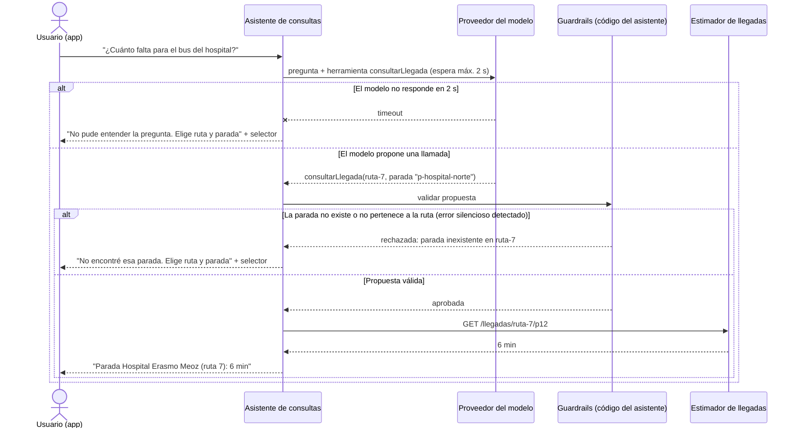

# ADR-002: Tool-calling con guardrails para la pregunta en texto libre "¿cuándo llega mi bus?" en la app, con el selector de ruta y parada como camino sin modelo

**Estado:** propuesto

---

## Contexto y fuerzas

Hoy el usuario de la app consulta la llegada eligiendo una ruta y una parada (`GET /llegadas/:rutaId/:paradaId`). El caso pide que la app permita preguntar en lenguaje natural, por ejemplo "¿cuánto falta para el bus que va a la Diagonal Santander?". El usuario no siempre conoce el identificador de la ruta ni el nombre oficial de la parada: usa nombres populares, barrios o puntos de referencia.

Las fuerzas que pesan en esta decisión, tomadas del caso:

- **Un error del modelo no lanza excepción.** Si el modelo interpreta "la parada del hospital" como otra parada, la app mostraría un tiempo de llegada válido para el lugar equivocado y el usuario perdería el bus. El error es silencioso, por eso tiene que haber un control antes de que la respuesta llegue al usuario.
- **El dato de llegada se refresca cada 15 segundos (RF-03).** Si la respuesta del modelo tarda más que eso, el usuario recibe una estimación que ya cambió. El tiempo máximo de espera del modelo tiene que ser bastante menor que 15 s.
- **El presupuesto está topado por contrato** y un mismo dato lo leen miles de usuarios (escenario 2, fan-out). Si cada consulta del mapa o de las pantallas pasara por el modelo, el costo crecería con cada lector, que es justo lo que el ADR-000 quiso evitar.
- **Las 40 pantallas de estación ya saben en qué parada están.** Para ellas no hay nada que interpretar.
- **Datos que recibe el modelo.** Para proponer `parada_id` el modelo necesita conocer las paradas, así que recibe el texto de la pregunta y el catálogo público de rutas y paradas (identificador, nombre oficial y nombres populares). No recibe la ubicación del usuario, su identidad ni posiciones de buses: el dato vivo se queda en el estimador. Así, lo que sale hacia el proveedor externo es información que ya es pública.
- **El modelo solo debe leer.** Consultar una llegada no cobra ni reserva nada, así que un error no es irreversible: el costo de equivocarse es una mala información, no una pérdida de dinero.
- **¿Se resuelve con un `if`?** Parcialmente. Una tabla de sinónimos de paradas resuelve los nombres conocidos, pero no las frases libres ("el que pasa por la terminal", "el de las 7 que va lleno").

Supuestos declarados (el caso no da estos datos):

- Supongo que la pregunta en texto libre solo existe en la app; las pantallas y la API pública no la usan.
- Supongo un tiempo máximo de espera de 2 s para el modelo: es menos del 15 % de la ventana de 15 s de RF-03, así que la estimación que se muestra sigue vigente.

## Decisión

Se usa un modelo de lenguaje **solo en la caja de texto libre de la app**, con el patrón **tool-calling + guardrails**:

1. El contenedor nuevo *Asistente de consultas* envía la pregunta y el catálogo de rutas y paradas al proveedor del modelo junto con **una única herramienta**: `consultarLlegada(ruta_id, parada_id)`, que es de solo lectura.
2. El modelo no responde el tiempo de llegada; solo **propone** la llamada con una ruta y una parada.
3. El código del asistente (guardrails) valida la propuesta antes de ejecutarla: la ruta existe, la parada existe y pertenece a esa ruta, y la herramienta es la única permitida.
4. Si la propuesta es válida, el asistente llama al estimador de llegadas existente y la app muestra el resultado, siempre con el nombre de la parada interpretada ("Llegada a la parada *Hospital Erasmo Meoz*: 6 min"), para que el usuario vea qué entendió el sistema.
5. Si el modelo falla, la app cae al **selector de ruta y parada** que ya existe (camino sin modelo).

El mapa en vivo, las pantallas de estación, las alertas y la API pública **no usan el modelo**.

## Alternativas descartadas

1. **Sin modelo de lenguaje: solo el selector de ruta y parada, más una tabla de sinónimos.** Es la opción más barata y sin errores silenciosos, y por eso se conserva como camino alternativo. Se descarta como única opción porque no resuelve las frases libres que el caso pide atender. Si la medición de abajo no alcanza el mínimo, esta es la decisión a la que se vuelve.
2. **RAG.** No hay documentos que buscar: el dato que el usuario pide (la llegada) es un dato vivo que ya calcula el estimador. Recuperar texto no aporta nada y agrega un punto de falla (recuperar el fragmento equivocado).
3. **Human-in-the-loop.** La acción es una consulta de solo lectura que se responde en segundos. Ninguna persona puede aprobar miles de consultas dentro de la ventana de 15 s, y el error no es irreversible.
4. **Que el modelo responda directamente el tiempo de llegada.** El modelo no tiene el dato vivo y lo inventaría. Por eso solo propone la llamada y el número sale del estimador.

## Modo de falla y control

El diagrama muestra el **momento del error** (el modelo no responde o propone una parada que no existe), **qué lo detecta** (el timeout de 2 s y la validación de los guardrails) y **cómo termina** (el usuario recibe el selector de ruta y parada, que es el camino sin modelo).

Hay un error que el guardrail no puede detectar: que el modelo proponga una parada **que sí existe pero no es la que el usuario quería**. Por eso la respuesta siempre muestra el nombre de la parada interpretada, para que el usuario lo note, y por eso se mide el porcentaje de aciertos.

## Cómo se mide que funciona

- **Conjunto de casos:** 60 preguntas en texto libre, escritas por el grupo con nombres populares de paradas y frases ambiguas, cada una con la ruta y la parada correctas. Supongo 60: tres formas distintas de preguntar por cada una de 20 paradas de referencia que escoge el grupo.
- **Aciertos mínimos:** el 90 % de las preguntas debe terminar en la ruta y la parada correctas.
- **Guardrails:** el 100 % de las propuestas con una parada inexistente o de otra ruta debe ser rechazado (se prueba con el adaptador simulado del modelo devolviendo propuestas inválidas a propósito).
- **Tiempo:** si el modelo no responde en 2 s, el 100 % de los casos debe terminar en el selector.

La prueba se corre con un **adaptador simulado del modelo** con respuestas predefinidas; no es obligatorio conectar un proveedor real.

Ejecutar los guardrails automatizados: `npm run guardrails`.

## Consecuencias

**Mejora:**
- El usuario puede preguntar como habla, sin conocer el identificador de la ruta ni el nombre oficial de la parada.
- El número que ve siempre sale del estimador, nunca del modelo.
- Si el proveedor del modelo se cae, la app sigue funcionando con el selector.

**Empeora / costo que se acepta:**
- Cada pregunta en texto libre cuesta una llamada al proveedor, dentro de un presupuesto topado. Por eso el modelo se limita a la caja de texto y no a las pantallas ni al mapa.
- La consulta en texto libre puede tardar hasta 2 s más que la consulta con selector.
- Aparece un sistema externo nuevo que hay que monitorear.
- Queda un error que solo el usuario puede detectar (una parada real pero equivocada). Se mitiga mostrando la parada interpretada.
